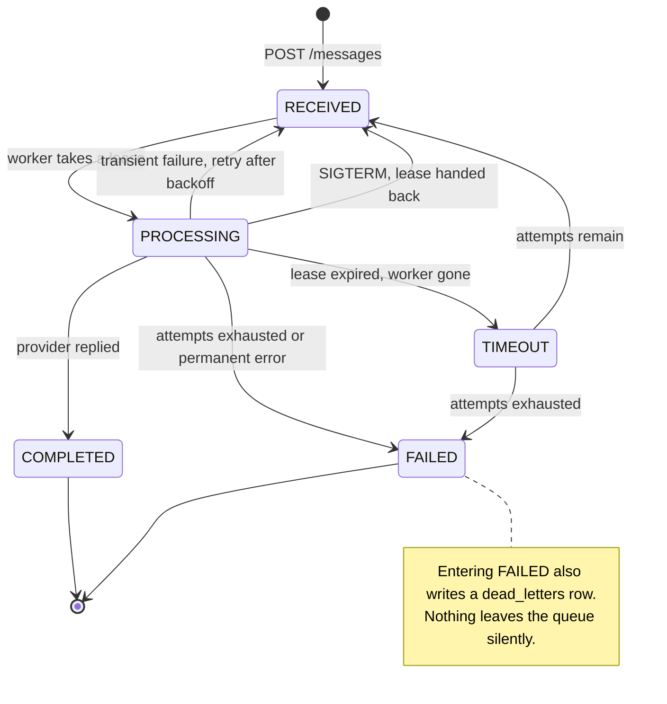
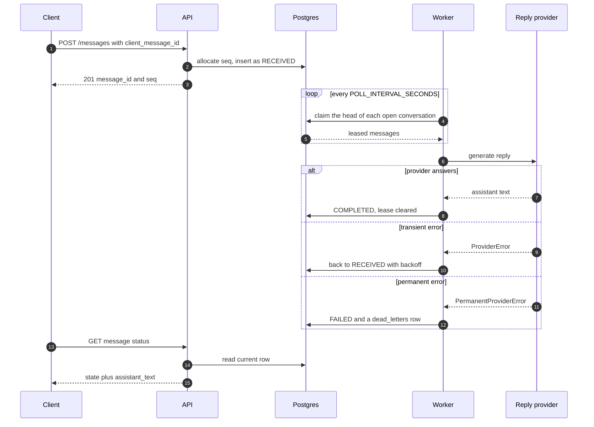

# AILA Messaging Backend

A take-home built around one awkward requirement: **accept a message instantly,
answer it slowly, and never let the answer arrive in the wrong place.**

`POST /messages` returns in milliseconds with a durable `message_id` and a
sequence number. A separate worker process picks the message up later, asks a
reply provider for an answer, and writes it back. The reply can take four
minutes, can fail, and can be retried — and the conversation still reads back in
the order the user typed it.

```bash
curl -s -X POST http://localhost:7221/messages \
  -H 'Content-Type: application/json' \
  -d '{"user_id":"u1","conversation_id":"c1","text":"What is tax deduction?"}'
```

```json
// abridged - the full body also carries the ids, text and timestamps
{"message_id":"0fde9363-c3f4-4e8b-8c97-4ab5105a92bb","seq":2,"state":"RECEIVED",
 "assistant_text":null,"attempt_count":0,"provider":null}
```

Postgres is both the store and the queue. There is no broker: the worker claims
work with `SELECT ... FOR UPDATE SKIP LOCKED`, which is enough for this shape of
problem and removes a moving part from the deployment.

## What the API actually guarantees

| Promise | How | Where |
|---|---|---|
| Accepted means durable | Committed before the response is written | `app/service.py` |
| A repeat is not a second message | `client_message_id` is a unique index, and the replay path answers 200 rather than 500 | `app/service.py` |
| A thread *reads* in send order | `seq` is allocated atomically per conversation and never reused | `app/repository.py` |
| A thread is *answered* in send order | A message is only claimable when no lower `seq` in it is still open | `app/queue.py` |
| A crashed worker strands nothing | Every claim is a lease, and expired leases are reaped | `app/queue.py` |
| A bad message does not wedge the queue | Permanent provider errors dead-letter on the first attempt | `app/providers/base.py` |

## The life of a message





## Delivery semantics, spelled out

These are the questions a reviewer opens a delivery service to ask, so they are
answered here rather than left to be inferred.

**At-least-once, not at-most-once.** A message moves to `PROCESSING` *before*
the provider is called and to `COMPLETED` *after* it returns. A worker that dies
in between leaves a row whose lease expires and is retried, so the same message
can reach the provider twice. `ReplyRequest.idempotency_key` is stable across
attempts for exactly that reason, and the OpenAI provider sends it as an
`Idempotency-Key` header.

**Every acknowledgement is guarded.** `complete`, `fail` and `release` all
update `WHERE state = 'PROCESSING' AND attempt_count = <the attempt I claimed>`.
If the lease was reaped and someone else re-claimed the message, the update
touches zero rows and the worker logs `lease_lost` rather than overwriting
another worker's result.

**Retries are bounded and jittered.** `MAX_ATTEMPTS` caps them, backoff is
`BACKOFF_BASE_SECONDS * BACKOFF_FACTOR^(attempt-1)` capped at
`BACKOFF_MAX_SECONDS`, and `BACKOFF_JITTER` stops a batch that failed together
from coming back together.

**Ordering is enforced, not just claimed.** Read order comes from `seq`.
Delivery order comes from the claim query, which skips any message with an
earlier open `seq` in the same conversation. That is head-of-line blocking on
purpose: a retried message holds its thread rather than being overtaken.
Different conversations never block each other. Set
`STRICT_CONVERSATION_ORDER=false` to trade the guarantee for throughput.

**Poison messages leave.** A `PermanentProviderError` dead-letters on the first
attempt instead of cycling to `MAX_ATTEMPTS`. Any *other* unexpected exception is
caught per message, so one bad payload fails that message and the loop carries
on. Dead letters are readable at `GET /dead-letters`.

**SIGTERM does not strand work.** The worker stops claiming, gives in-flight
messages `SHUTDOWN_GRACE_SECONDS` to finish, and hands back whatever is still
running — restoring `RECEIVED` and *decrementing* `attempt_count`, because an
interrupted message is not a failed one. Observed on a real `kill -TERM` with a
120-second provider delay and a 2-second grace:

```
// worker log, timestamp and worker_id fields elided
{"event": "draining", "inflight": 1, "grace_seconds": 2.0}
{"event": "released_on_shutdown", "message_id": "8a0706c1-...", "attempt": 1, "released": true}
```

The row went from `PROCESSING / attempt_count 1 / leased` to
`RECEIVED / attempt_count 0 / lease cleared`.

## Running it

### With Docker

```bash
cp backend/.env.example backend/.env    # optional, all values have defaults
docker compose up --build
```

- API: <http://localhost:7221> — OpenAPI docs at `/docs`
- Postgres: `localhost:7222`

One image, two targets (`--target api`, `--target worker`), both running as the
non-root `aila` user. The worker gets `stop_grace_period: 30s` so the drain above
finishes before the runtime escalates to `SIGKILL`.

### Without Docker

The test-suite and a single-process run need no Postgres and no API key.

```bash
cd backend
python -m venv .venv && source .venv/bin/activate
pip install -r requirements-dev.txt

export DATABASE_URL="sqlite+aiosqlite:///./aila.db"
export REPLY_PROVIDER=echo

uvicorn app.main:app --port 7221     # terminal 1
python -m worker                     # terminal 2
```

SQLite is a development convenience: the claim query drops its row locking there,
since SQLite serialises writers anyway. `backend/tests/test_sql_dialect.py`
compiles the same statement against the PostgreSQL dialect and asserts the
`FOR UPDATE OF messages SKIP LOCKED` that production depends on.

## Talking to it

```bash
# Read a thread. Ordered by seq, not by completion time.
curl -s "http://localhost:7221/conversations/u1?conversation_id=c1&limit=20"

# Poll one message, then see what is stuck and what gave up.
curl -s "http://localhost:7221/messages/<message_id>/status"
curl -s http://localhost:7221/metrics
curl -s http://localhost:7221/dead-letters
```

Re-sending a `client_message_id` that was already accepted answers 200 with the
original message and an `Idempotent-Replay: true` header.

| Endpoint | Purpose |
|---|---|
| `POST /messages` | Queue a message. 201 on create, 200 + `Idempotent-Replay: true` on replay |
| `GET /messages/{id}/status` | State, attempt count against the budget, reply or last error |
| `GET /conversations/{user_id}` | Paginated thread history, filterable by `conversation_id` and `state` |
| `GET /dead-letters` | Messages that exhausted their retries, with the reason |
| `GET /healthz`, `GET /readyz` | Liveness, and readiness that runs a real query and answers 503 when the database is gone |
| `GET /metrics` | Queue depth per state, dead-letter count, active configuration |

`/metrics` from a live run, three messages queued and none picked up yet:

```json
{"received":3,"processing":0,"completed":0,"failed":0,"timeout":0,"dead_letters":0,
 "conversations":1,"total":3,"provider":"echo","max_attempts":3,
 "strict_conversation_order":true}
```

## Where the reply comes from

The worker never calls a model directly. It calls a `ReplyProvider`
(`backend/app/providers/base.py`), which is how the suite runs offline and how a
real model is swapped in without touching the queue.

| `REPLY_PROVIDER` | Behaviour | Credentials |
|---|---|---|
| `echo` | Deterministic local reply derived from the message text | none |
| `simulated` *(default)* | The assignment's random delay and `REPLY_FAIL_RATE`, wrapping one of the others | none |
| `openai` | Chat completions against any OpenAI-compatible endpoint | `OPENAI_API_KEY` |

The provider, not the worker, decides what is retryable: `ProviderError` means
try again, `PermanentProviderError` means stop. The OpenAI provider maps 5xx and
429 to the first and other 4xx to the second, because retrying a 400 forever is
how queues die. `simulated` seeds a private `random.Random`, so `REPLY_SEED`
makes the failure pattern reproducible without touching global state.

## Tests

Every setting above has a default and lives in `backend/.env.example`.

```bash
cd backend
pip install -r requirements-dev.txt
pytest          # 68 passed
ruff check .    # All checks passed!
```

No Postgres, no Docker, no API key. The suite goes after the parts that are easy
to get wrong rather than the parts that are easy to test: the idempotency race
where both requests miss the pre-check (`test_idempotency.py`), a retried message
still blocking its successors (`test_ordering.py`), an expired lease at max
attempts being dead-lettered instead of stalling in `TIMEOUT` (`test_queue.py`),
and `SIGTERM` returning an in-flight message to the queue without spending an
attempt (`test_worker.py`).

## What this is not

It is a take-home, and these are deliberate omissions rather than oversights:

- **No migrations.** Tables are created on startup (`AUTO_CREATE_SCHEMA`).
  Anything real wants Alembic.
- **No auth.** `user_id` is whatever the caller says it is.
- **Polling, not push.** `GET /messages/{id}/status` is the only way to watch a
  message. SSE or a websocket would be the next thing to add.
- **No replay endpoint.** Dead letters can be read but not re-queued.
- **`/metrics` is JSON, not Prometheus.** Enough to see queue depth, not enough
  to alert on.
- **The Docker images have not been built or booted here** — only
  `docker compose config` was validated. The native run above is what was
  exercised end to end.
