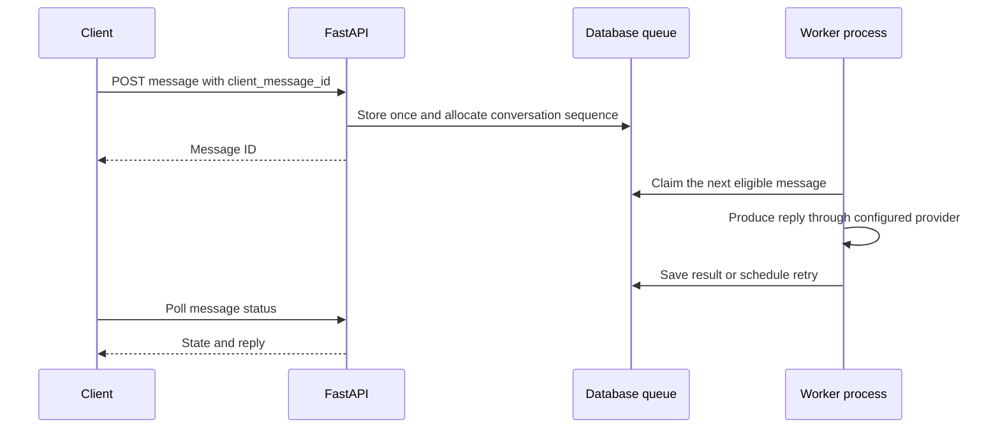
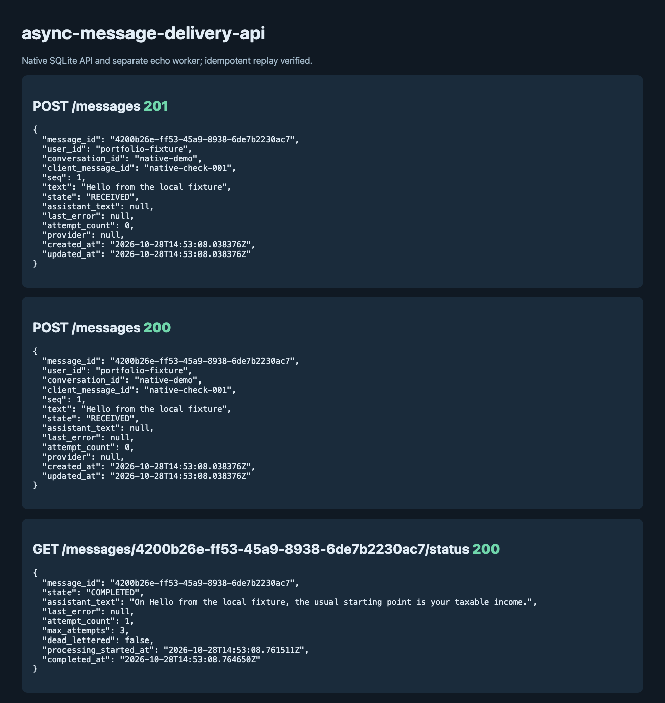

# AILA Messaging Backend

A small message delivery service. `POST /messages` stores the message and returns right away with a `message_id` and a per-conversation `seq`. A separate worker process picks it up later, asks a reply provider for an answer and writes the reply back. Built as a take-home exercise.

Postgres is used as both the database and the queue. The worker claims messages with `SELECT ... FOR UPDATE SKIP LOCKED`, so there is no separate broker.

## Features

- Idempotent sends: repeating a `client_message_id` returns the original message with a 200 and an `Idempotent-Replay: true` header
- Messages in a conversation are numbered and answered in send order
- Leases on claimed messages, so a crashed worker's messages get picked up again
- Bounded retries with exponential backoff and jitter, then a `dead_letters` row
- Graceful shutdown: on SIGTERM the worker hands in-flight messages back to the queue
- Pluggable reply providers: `echo`, `simulated` (default) and `openai`

Stack: Python, FastAPI, SQLAlchemy (async), Postgres 16, pytest.

## Running with Docker

```bash
cp backend/.env.example backend/.env   # optional
docker compose up --build
```

The API is on http://localhost:7221 (OpenAPI docs at `/docs`) and Postgres on port 7222. The compose file starts three services: `db`, `api` and `worker`.

## Running without Docker

SQLite works for local runs and tests, so you don't need Postgres or an API key:

```bash
cd backend
python -m venv .venv && source .venv/bin/activate
pip install -r requirements-dev.txt

export DATABASE_URL="sqlite+aiosqlite:///./aila.db"
export REPLY_PROVIDER=echo

uvicorn app.main:app --port 7221   # terminal 1
python -m worker                   # terminal 2
```

All settings have defaults and are listed in `backend/.env.example`.

## API

| Endpoint | What it does |
|---|---|
| `POST /messages` | Queue a message |
| `GET /messages/{message_id}/status` | Current state, attempts and the reply if there is one |
| `GET /conversations/{user_id}` | Thread history, filterable by `conversation_id` and `state` |
| `GET /dead-letters` | Messages that ran out of retries |
| `GET /healthz`, `GET /readyz` | Liveness and readiness |
| `GET /metrics` | Queue counts per state (JSON) |

Example:

```bash
curl -s -X POST http://localhost:7221/messages \
  -H 'Content-Type: application/json' \
  -d '{"user_id":"u1","conversation_id":"c1","text":"What is tax deduction?"}'
```

## Tests

```bash
cd backend
pytest
ruff check .
```

The tests run on SQLite. `tests/test_sql_dialect.py` compiles the claim query against the Postgres dialect to check the `SKIP LOCKED` clause.

## Notes

- Tables are created on startup (`AUTO_CREATE_SCHEMA`), there are no migrations yet.
- No authentication, `user_id` is trusted as sent.
- Clients poll for status. Server-sent events or websockets would be a reasonable next step.

## From send to reply





This run used a fresh SQLite database and a separate echo worker. Repeating the
client message ID returned the original message, then polling returned its reply.
[HTTP exchange record](docs/native-api.json). SQLite does not validate PostgreSQL's
concurrent `SKIP LOCKED` claims; that still needs a multi-worker PostgreSQL run.
